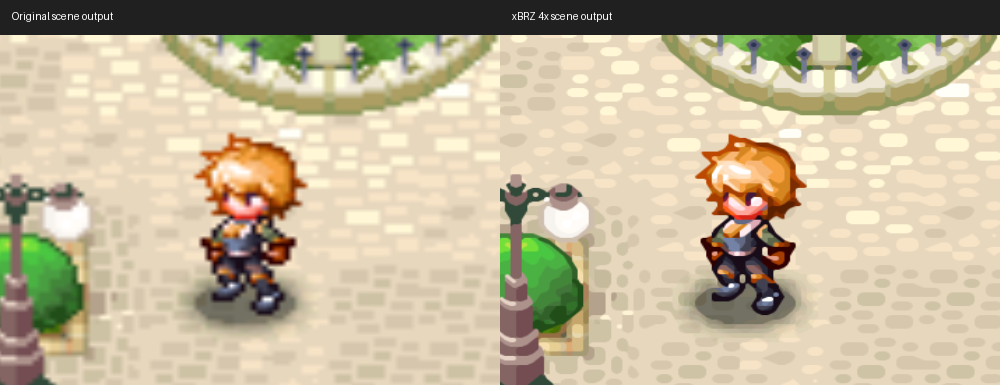

# SEED3 - Heroes in Time (种子3 / SEED 3) — Android 15 compatibility and Chinese UI localization

[简体中文](README.md)

Compatibility patches, layout fixes and ongoing Simplified Chinese UI localization for SEED3 - Heroes in Time (SEED 3). The latest release is **v0.15.0 HD experiment**, packaged as `SEED3-scene-HD-experiment-v15.apk`.

[Download APK](https://github.com/WSX-LY/SEED3-Heroes-in-Time-Android15-Chinese/releases/download/v0.15.0/SEED3-scene-HD-experiment-v15.apk) · [Release and checksums](https://github.com/WSX-LY/SEED3-Heroes-in-Time-Android15-Chinese/releases/tag/v0.15.0)

## Static asset collaboration pack (2026-11-27)

Developers and agents can share upscaling and detail-restoration work. The pack contains **1,157 native images**, or **2,094 entries including palette variants and Android drawable bitmaps**, grouped into **835 source-level tasks**. Coverage is limited to identified CBM/CMB and drawable image formats; unknown embedded images and all animation/map assembly relationships have not been exhaustively identified.

Start with the [pack README](static-assets/README.md), [agent rules](static-assets/AGENTS.md), and [workflow](static-assets/WORKFLOW.md) (Chinese). [Originals](static-assets/originals/), [stable mapping](static-assets/mapping.json), [task queue](static-assets/tasks.json), and [submission example](static-assets/submission.example.json) are included. A coordinator assigns task IDs and owners before work begins; keep each source file's images and palettes together.

Use original dimensions as the baseline: backgrounds/characters at 4×, other assets at 2×. Inspect images before classification; prefer xBRZ for pixel art and Real-ESRGAN for illustrations. Generated detail candidates should record their model and prompts. Existing v12 startup/menu assets are frozen; coordinate before reworking other existing HD assets. Preserve alpha, atlas layout, slice positions, and animation consistency.

Submit RGBA PNGs, comparison images, and an isolated submission.json under `static-assets/submissions/<task_id>/<author>/`. From the repository root, with Python and Pillow:

```powershell
python tools/asset-workflow.py validate static-assets/submissions/<task_id>/<author>
```

The validator checks source hashes, task coverage, dimensions, scale, obvious transparency loss, and path traversal. Visual quality, seams, animation, and runtime behavior still require review. Do not rerun the exporter during collaboration: it overwrites the baseline. Original-size inputs come from the current decoded tree and may include existing localization.

**This is an offline asset pack and submission protocol. APK mapping consumption and independent native HD texture loading are not implemented.** Real-time scene xBRZ is separate. No new APK or release is published with this change. Original game asset rights remain with their owners.

## v0.15.0 changes

- Add 639 UI assets at 2× and 23 floating character illustration/expression assets at 4×; retain the 2× startup/menu assets.
- Add real-time xBRZ 4× scene output, from 512×256 to 2048×1024. Independent 4× scene source textures are not yet integrated.
- Preserve equipment layouts with higher-density assets; include native image/animation parsers, build source and an A/B toggle.
- Checked on vivo V2170A / Android 15: town, brief movement, character page and A/B switching. Combat, all maps, sustained thermal behavior and other devices remain untested.
- Cumulative filter/upload averages were about 12ms/1ms, with roughly 73MiB for lookup/frame buffers. This is experimental; previous releases remain available for rollback.



## v0.11.0 changes

- Target Android API 28 and adapt legacy HTTP, private cache files and explicit billing-service binding.
- Remove installed-app enumeration, the legacy memory-tool check and phone identifier reads.
- Remove Facebook and OpenFeint title-screen links.
- Expand Chinese text for Help, Option, the shop and secondary dialogs, with font fixes.
- Replace real-payment entry points with free local claims. Unlock flags and points are stored locally. Restore reads local records. Uninstallation removes local data.
- Use the original in-game INFO/confirmation panel for purchase feedback and restore the description font size. The user accepted the v11 build on 2026-11-25.

Local records do not restore historical server-side purchases. Full regression testing across all items and gameplay remains outstanding.

## Changes

- Fix resource scanning stopping on a directory and failing to register CHFONT.
- Correct a native skill JNI array type mismatch.
- Update dynamic resource package names and guard missing skill bitmaps.
- Keep the right-hand skill and attack buttons within their container.
- Fix duplicate font scaling in character statistics and inventory counters.
- Reduce skill list text and explicitly size skill detail text in pixels.
- Translate 62 Android strings, four save messages, and the first quest title and instructions.
- Add Seed3Diag startup, menu and resource lookup logs.

## Game names

The game is commonly listed in Chinese as 种子3 and in English as SEED3 - Heroes in Time or SEED 3. The supplied APK title screen reads SEED III: Wheel of Fortune. This project provides Android 15 compatibility fixes and partial Simplified Chinese UI localization.

[Chinese listing](https://m.ali213.net/android/16165.html) · [English listing](https://www.taptap.cn/app/41768)

## Download and installation

Download the APK from Releases. The compatibility package is `ch.kingdoms.market.compat`.

On the tested phone, replacing an installed build failed. Uninstall the previous compatibility build before installation. Uninstallation removes local saves, so preserve any data you need first.

```powershell
adb devices -l
adb uninstall ch.kingdoms.market.compat
adb install --no-incremental --bypass-low-target-sdk-block SEED3-scene-HD-experiment-v15.apk
adb shell am start -n ch.kingdoms.market.compat/ch.kingdoms.kor.KingdomsActivity
```

Check each command result. Uninstallation and installation should report Success. If the package is absent, verify its state and install directly.

## Validation and limitations

Tested on vivo V2170A running Android 15. Verified startup, menus, right-hand controls, character status, inventory counters, Chinese text for the first quest, and skill list font size. Skill detail font sizes are patched but visually unverified because the test character has locked skills. Full story, combat and end-to-end regression testing remain outstanding.

Localization is incomplete. Only the first of 135 quest records is translated. Many other strings and image-based labels remain English. Story localization is deferred. Legacy online services may still report errors.

## Source and build

`decoded/` contains the current Apktool project. `tools/` contains historical patch scripts and translation mappings. Read historical scripts before using them. Some have development-machine paths and one-time assertions, and must not all be rerun against the current project. `AGENTS.md` records collaboration and device procedures in Chinese.

Use Java, Apktool 2.12.1 and Android SDK Build Tools. Build from an ASCII-only path. Supply your own signing keystore.

```powershell
java -jar tools/apktool.jar b decoded -o unsigned.apk
zipalign -f 4 unsigned.apk aligned.apk
apksigner sign --ks YOUR_KEYSTORE --out SEED3-scene-HD-experiment-v15.apk aligned.apk
apksigner verify SEED3-scene-HD-experiment-v15.apk
```

Tool binaries, original APKs, build outputs, logs and signing keys are excluded from Git. Obtain Apktool from its official releases.

## Rights

This is an unofficial compatibility and translation project. Original game code, artwork, names and other content remain the property of their respective rights holders. This repository grants no additional license to third-party game content.


## HD preview and next steps

The source includes 18 startup and main-menu assets upscaled 2× for v12 using Real-ESRGAN and xBRZ. Resource density preserves their original display size. The title touch screen has been verified on the device; individual main-menu buttons still need review. The latest release is the v0.15.0 HD experiment.

Keep the startup and main-menu assets as they are. Future work uses 4× for backgrounds and characters and 2× for other assets, measured from the original source. Preserve layout and touch areas, and check visual quality, memory use and loading.

`tools/upscale-menu.py` and `tools/scale-xbrz.mjs` record the 2× preview workflow and contain development-machine paths that must be adjusted. Dependencies: Python/Pillow, Node.js, `@kayahr/xbrz`, `pngjs`, and Real-ESRGAN ncnn-vulkan with the `realesr-animevideov3` model. Tool binaries and models are not included.

### In-game UI HD preview v14

Adds 639 UI assets at 2× (xBRZ) and 23 floating character illustration/expression assets at 4× (Real-ESRGAN). Covers status bars, directional controls, attack/skill slots, menus, inventory/skill icons, panels and popups. Scene maps and walking sprites are unchanged; startup and main-menu assets retain v12. Original artwork is retained. Density qualifiers preserve display size, with a compatibility fix for equipment layouts that use raw image bounds.

Scripts and manifests: `tools/upscale-ui.py`, `tools/upscale-ui-characters.py`, `tools/hd-ui-manifest.json`, `tools/hd-ui-characters-manifest.json`. Dependencies are listed above; both Python scripts accept `--project` and `--work` arguments.

The intermediate v13 was checked on-device across the main controls and major menus. Empty inventory and locked skills limit coverage. v14 is installed. On-device checks confirmed the main controls and character page retain their layout and the 4× character illustration displays correctly. No crash or out-of-memory errors were found in the current process log. Other NPC illustrations, expressions and all item detail states have not been individually reviewed. The latest release is the v0.15.0 HD experiment.

### Real-time scene 4× experiment v15

The completed 512×256 scene is upscaled using xBRZ to 2048×1024 at texture upload, retaining the v14 UI. Independent 4× character/map source textures are not yet integrated. Town A/B toggling, brief movement and the character page were checked. Cumulative filter/upload averages were about 12ms/1ms on the connected phone, with approximately 73 MiB for lookup/frame buffers. Combat, all maps and sustained performance remain untested.

Native image and animation parsers are included. See the [technical notes](tools/native-scene-hd/README.md) for source, build instructions, device restrictions and the A/B toggle. The latest release is the v0.15.0 HD experiment.
